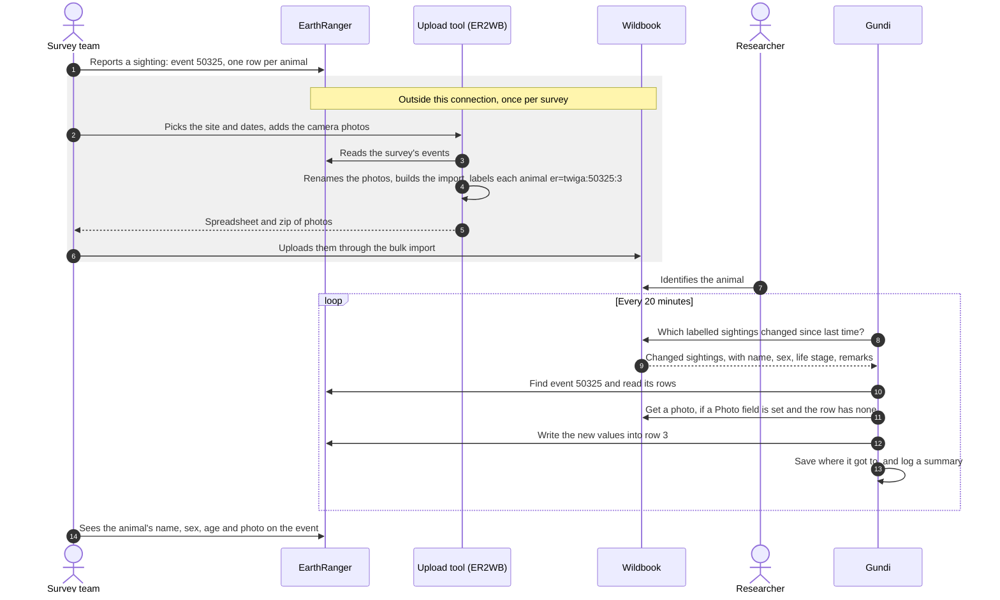

# Wildbook to EarthRanger

This connection brings what **Wildbook** learns about an animal back into the
**EarthRanger** event where the animal was first reported. When an animal in a
sighting is identified in Wildbook, the connection writes its name, sex, age,
notes and a photo into that animal's row on the EarthRanger event.

It runs through [Gundi](https://gundiservice.org), so nobody has to copy
results from one system to the other by hand.

## A typical day

1. A ranger records a sighting in EarthRanger. The event has a list with one
   row per animal seen (for example a herd of giraffes).
2. After the survey, the team runs an **upload tool** that turns the
   EarthRanger events and the camera photos into a Wildbook bulk import. For the
   Giraffe Conservation Foundation (GCF) this tool is **ER2WB**. It adds a short
   label to each animal's remarks that points back to the event and the row it
   came from, such as `er=twiga:50325:3` (site *twiga*, event *#50325*,
   row *3*).
3. A person uploads the spreadsheet and photos to Wildbook through its bulk
   import.
4. Researchers match the animals in Wildbook.
5. A few minutes later, Gundi fills in that row on the EarthRanger event with
   what Wildbook now knows.

## The upload tool

This connection only brings information **back** from Wildbook. Getting the
sightings **into** Wildbook, with their labels, is the upload tool's job. GCF's
ER2WB is a web app GCF built and runs once per survey:

1. It reads the survey's events from EarthRanger, for a site and date range the
   user picks.
2. It renames the camera photos so each is unique, and builds a Wildbook
   bulk-import spreadsheet plus a zip of the photos.
3. It writes the label `er=<site>:<event number>:<row>` into each animal's
   remarks.
4. A person uploads the spreadsheet and photos to Wildbook (for GCF,
   GiraffeSpotter) through Wildbook's bulk import.

ER2WB only goes from EarthRanger to Wildbook. Together, the two make a round
trip: ER2WB takes the sightings to Wildbook, and this connection brings the
results back to EarthRanger.

An organisation needs ER2WB or a tool like it. The labels are how the
connection knows which event and row each Wildbook sighting belongs to.

## What's in scope

| From Wildbook | Goes into the animal's row in EarthRanger |
|---|---|
| The animal's name (for example `HNBF093`) | The **ID** field you choose |
| Sex (male, female, unknown) | The **Sex** field you choose |
| Life stage (adult, subadult, juvenile, calf, unknown) | The **Age** field you choose |
| The sighting's remarks | Added to the end of the **Notes** field you choose |
| One photo of the animal | The **Photo** field you choose, if it's empty |

Photos are a welcome addition on EarthRanger: they come from the field team's
camera through the upload tool, and most events don't have one attached yet
(on GCF's site, 77 of 2,244 giraffe events in 2026).

- Every field is optional. You pick which ones to fill in, and the rest of the
  event stays as it is.
- It works with any event type that has a list of animals with those fields,
  for any species.
- One Wildbook connection can update several EarthRanger sites.
- Each run leaves a short report in the Gundi portal's activity log: how many
  rows were updated, how many photos were added, and which sightings were
  skipped and why.

## What's out of scope

These are handled elsewhere, or by people:

- **Getting sightings into Wildbook.** Uploading photos to Wildbook, and adding
  the `er=` label to each sighting, is done by the organisation's
  [upload tool](#the-upload-tool), for example GCF's ER2WB.
- **Creating EarthRanger events.** The connection only updates events that
  already exist.
- **Matching animals.** That is done in Wildbook. A sighting whose animal isn't
  identified yet waits until it is.
- **Changing anything else on the event**, such as its title, location,
  status, other fields, or rows without a label.
- **Clearing values.** The connection fills in and corrects values. It never
  empties a field.
- **Replacing photos.** A row that already has a photo keeps it.
- **Sending EarthRanger edits back to Wildbook.** Information flows one way,
  from Wildbook to EarthRanger.

## How it works

## How long it takes

- Gundi checks Wildbook **every 20 minutes**.
- It leaves out changes from the last **5 minutes**, because Wildbook needs a
  moment to make them searchable. The next run picks them up.
- So a change in Wildbook usually shows up in EarthRanger **5 to 25 minutes**
  later.
- A large batch (for example the first run over months of sightings) can take a
  few runs to get through. Each run picks up where the last one stopped.
- The time it takes to upload photos to Wildbook and match the animals isn't
  part of this, and depends on the people doing that work.

## Next

- [**Setup**](setup.md): what you need in Gundi, Wildbook and EarthRanger, and
  each setting.
- [**Good to know**](good-to-know.md): how values are matched, what gets
  skipped, and other details worth knowing.
